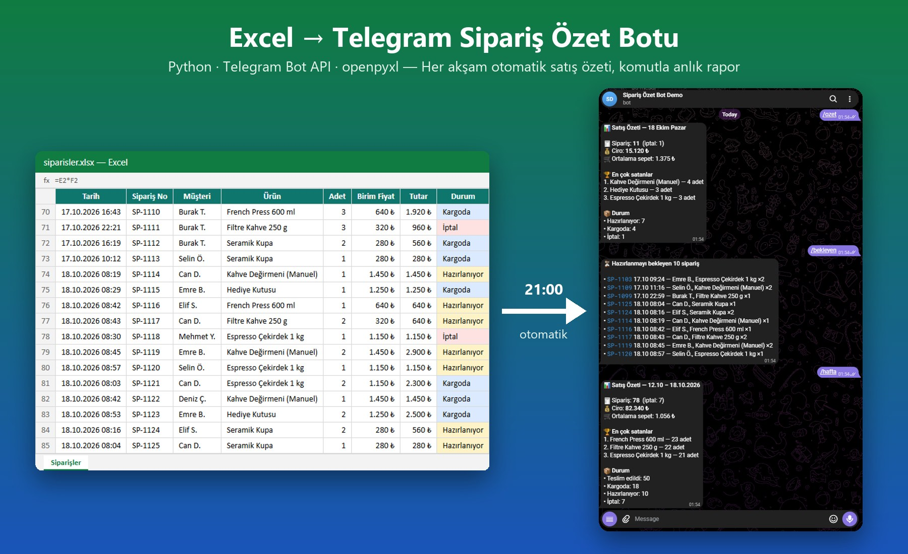

# Sipariş Özet Botu — Excel → Telegram

Excel'de tutulan sipariş tablosunu okuyup her akşam **günlük satış özetini Telegram'a gönderen**, komutlarla anlık rapor veren küçük bir otomasyon.
Küçük e-ticaret, kafe, butik gibi siparişlerini Excel'de takip eden işletmeler için örnek proje.



```
📊 Satış Özeti — 15 Ekim Perşembe

🧾 Sipariş: 12
💰 Ciro: 19.780 ₺
🛒 Ortalama sepet: 1.648 ₺
📈 Dün bu saate göre: +%127

🏆 En çok satanlar
1. Hediye Kutusu — 9 adet
2. Espresso Çekirdek 1 kg — 4 adet
3. French Press 600 ml — 3 adet

📦 Durum
• Hazırlanıyor: 9
• Kargoda: 3
```

## Özellikler
- Excel tablosunu (`.xlsx`) doğrudan okur. Formüllü tutar sütunu olsa bile adet × fiyat ile kendisi hesaplar.
- Günlük / dünkü / haftalık özet: ciro, sipariş sayısı, ortalama sepet, en çok satanlar, durum dağılımı
- Önceki dönemle karşılaştırma (gün bitmediyse dünün **aynı saatine** göre)
- Telegram komutları: `/ozet` `/dun` `/hafta` `/bekleyen` `/urunler` `/yardim`
- Sadece yetkili sohbete cevap verir
- Ek kütüphane olarak yalnızca `openpyxl` kullanır. Telegram bağlantısı standart kütüphaneyle yapılır.

## Kurulum
```bash
python -m venv .venv
.venv\Scripts\activate          # Linux/macOS: source .venv/bin/activate
pip install -r requirements.txt
python ornek_veri.py            # örnek siparisler.xlsx oluşturur
python bot.py --onizleme        # mesajı Telegram'a göndermeden görün
```

### Telegram'a bağlama
1. Telegram'da **@BotFather**'a `/newbot` yazın, bot token'ını alın.
2. `.env.example` dosyasını `.env` olarak kopyalayıp `TELEGRAM_TOKEN`'ı yazın.
3. `python bot.py --dinle` çalıştırın ve botunuza bir mesaj atın. Konsolda görünen chat id'yi `.env`'deki `TELEGRAM_CHAT_ID`'ye yazın.
4. `python bot.py --gonder` ile bugünün özetini gönderin.

### Her akşam otomatik gönderim
**Windows (Görev Zamanlayıcı):**
```bat
schtasks /create /tn "SiparisOzeti" /sc daily /st 21:00 /tr "C:\yol\demo-telegram-bot\.venv\Scripts\python.exe C:\yol\demo-telegram-bot\bot.py --gonder"
```
**Linux (cron):**
```
0 21 * * * /yol/.venv/bin/python /yol/bot.py --gonder
```

## Kendi tablonuza uyarlama
Bot, `Siparişler` sayfasındaki şu başlıkları arar: `Tarih, Sipariş No, Müşteri, Ürün, Adet, Birim Fiyat, Durum, Ödeme`.
Sütun sırası önemli değil. Farklı başlık adları için `siparisleri_oku()` fonksiyonunu düzenleyin.
